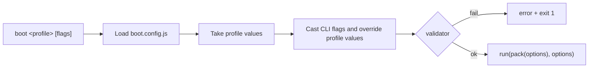

<div align="center">

# 🥾 boot-profiler

**Run your project with named profiles of typed CLI options.**

Describe options and profiles once in `boot.config.js`, then run
`boot development` or `boot production -u https://...`.

[](https://www.npmjs.com/package/boot-profiler)
[](https://www.npmjs.com/package/boot-profiler)

[](LICENSE)

</div>

---

## Table of contents

- [Why](#-why)
- [Installation](#-installation)
- [Quick start](#-quick-start)
- [How it works](#-how-it-works)
- [Configuration](#-configuration)
- [Built-in casts](#-built-in-casts)
- [Passing options to Vite](#-passing-options-to-vite)
- [API](#-api)
- [Roadmap](#-roadmap)
- [License](#-license)

## 💡 Why

Projects often run in several setups: local dev, staging, production, a demo
build with only some routes. Each one needs its own env variables, and over time
`package.json` fills up with long, copy-pasted scripts.

**boot-profiler** keeps it in one place:

- 🗂 **Profiles**: named sets of default option values
- ⌨️ **CLI overrides**: any option can be overridden with a flag, and `--help`
  is generated for you
- 🔢 **Typed values**: each CLI value is cast with a `cast` function (string,
  number, boolean, array, ...)
- ✅ **Validation**: invalid values stop the run with a clear error
- 📦 **Pack / unpack**: values are JSON-encoded for env variables, then decoded
  back with their types on the other side

## 📦 Installation

```bash
npm install --save-dev boot-profiler
```

This adds the `boot` command.

## 🚀 Quick start

**1. Create `boot.config.js` in the project root:**

```js
const { spawn } = require('child_process')
const { casts } = require('boot-profiler')

module.exports = {
  options: {
    ENV_MODE: {
      cast: String,
      flag: '-m',
      type: '<development|production>',
      help: 'build mode',
      validator: (value) => ['development', 'production'].includes(value),
    },
    ENV_API_URL: {
      cast: casts.StringCast,
      flag: '-u',
      type: '<url>',
      help: 'backend API address',
    },
    ENV_ROUTES: {
      cast: casts.ArrayCast,
      flag: '-r',
      type: '<a;b;c>',
      help: 'routes to include, separated by ";"',
    },
  },

  profiles: {
    development: {
      ENV_MODE: 'development',
      ENV_API_URL: 'http://localhost:3000',
      ENV_ROUTES: ['home', 'profile', 'admin'],
    },
    production: {
      ENV_MODE: 'production',
      ENV_API_URL: 'https://api.example.com',
      ENV_ROUTES: ['home', 'profile'],
    },
  },

  // packed: values as JSON strings (ready for process.env)
  // options: the same values with their real types
  run: (packed, options) => {
    const command = options.ENV_MODE === 'production' ? 'vite build' : 'vite'
    spawn(command, {
      shell: true,
      stdio: 'inherit',
      env: { ...process.env, ...packed },
    })
  },
}
```

**2. Add scripts:**

```json
{
  "scripts": {
    "dev": "boot development",
    "build": "boot production"
  }
}
```

**3. Run:**

```bash
npm run dev
npx boot production --ENV_API_URL https://staging.example.com
npx boot development -r "home;admin"
npx boot --help
```

## ⚙️ How it works



CLI flags always override profile values. Only CLI values go through `cast`,
because profile values are already written with the right types.

## 🛠 Configuration

`boot.config.js` must be in the directory where you run `boot` and must export
three fields:

| Field      | Type                                  | Description                                     |
| ---------- | ------------------------------------- | ----------------------------------------------- |
| `options`  | `Record<string, OptionDefinition>`    | Every option the project understands            |
| `profiles` | `Record<string, Record<string, any>>` | Named sets of option values                     |
| `run`      | `(packed, options) => void`           | Called with the final options                   |

**`OptionDefinition`**

| Key         | Required | Description                                                                     |
| ----------- | :------: | ------------------------------------------------------------------------------- |
| `cast`      |    ✅    | `(raw: string) => any`, turns the CLI string into a typed value                 |
| `flag`      |          | Short alias, e.g. `'-u'`. The long flag is always `--<OPTION_NAME>`             |
| `type`      |          | Value placeholder shown in `--help`, e.g. `'<url>'`                             |
| `help`      |          | Description shown in `--help`                                                   |
| `validator` |          | `(value) => boolean`. Returning `false` stops the run with an error             |

## 🔢 Built-in casts

Available as `require('boot-profiler').casts`:

| Cast                  | Input → Output                                      |
| --------------------- | --------------------------------------------------- |
| `StringCast`          | `"abc"` → `"abc"`                                   |
| `NumberCast`          | `"42"` → `42`                                       |
| `BooleanCast`         | `"true"` / `"false"` → `true` / `false`             |
| `StringOrNullCast`    | `"null"` → `null`, anything else → string           |
| `ArrayCast`           | `"a;b;c"` → `["a", "b", "c"]`                       |
| `ArrayOrAsteriskCast` | `"*"` → `"*"`, `"a;b"` → `["a", "b"]`               |

You can also use any function, such as `String`, `Number` or your own parser.

## ⚡ Passing options to Vite

`pack()` turns every option into a JSON string, so arrays and booleans can be
passed through environment variables. In `vite.config.js`, decode them with
`unpack()`:

```js
import { defineConfig, loadEnv } from 'vite'
import { unpack } from 'boot-profiler'

export default defineConfig(({ mode }) => {
  const env = unpack(loadEnv(mode, process.cwd(), 'ENV_'))

  env.ENV_ROUTES // → ['home', 'profile', 'admin'] (a real array)

  return {
    define: {
      __ROUTES__: JSON.stringify(env.ENV_ROUTES),
    },
  }
})
```

## 📖 API

```js
const { pack, unpack, casts } = require('boot-profiler')
```

| Export            | Description                                                                         |
| ----------------- | ----------------------------------------------------------------------------------- |
| `pack(options)`   | JSON-encodes the values of every key defined in `boot.config.js` → `options`        |
| `unpack(options)` | Reverses `pack`: JSON-decodes those keys back to typed values                        |
| `casts`           | Built-in cast functions (see above)                                                 |

Both `pack` and `unpack` read `boot.config.js` from the current directory to
know which keys to process.

## 🗺 Roadmap

- [ ] Load and pack variables from `.env` files
- [ ] Custom path to `boot.config.js`

## 📄 License

[MIT](LICENSE) © Eduard Lik
